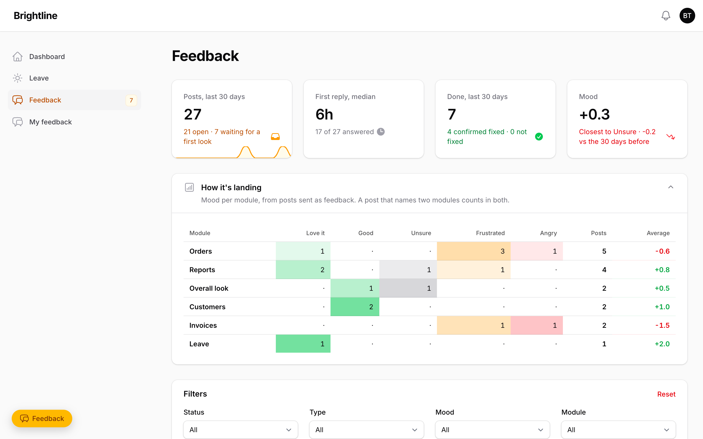
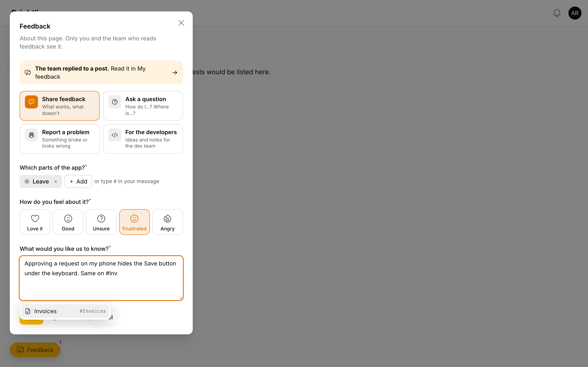
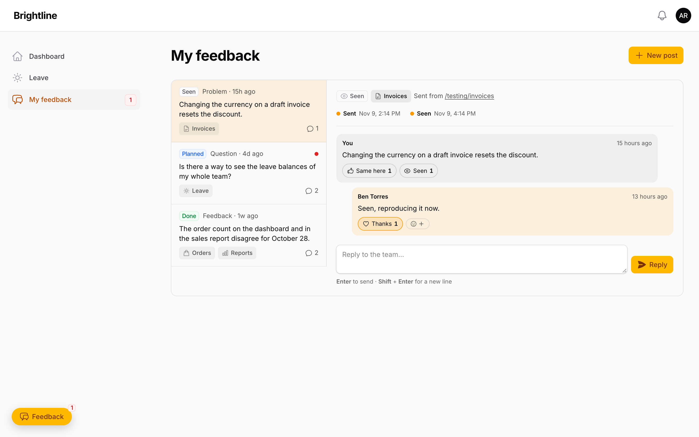
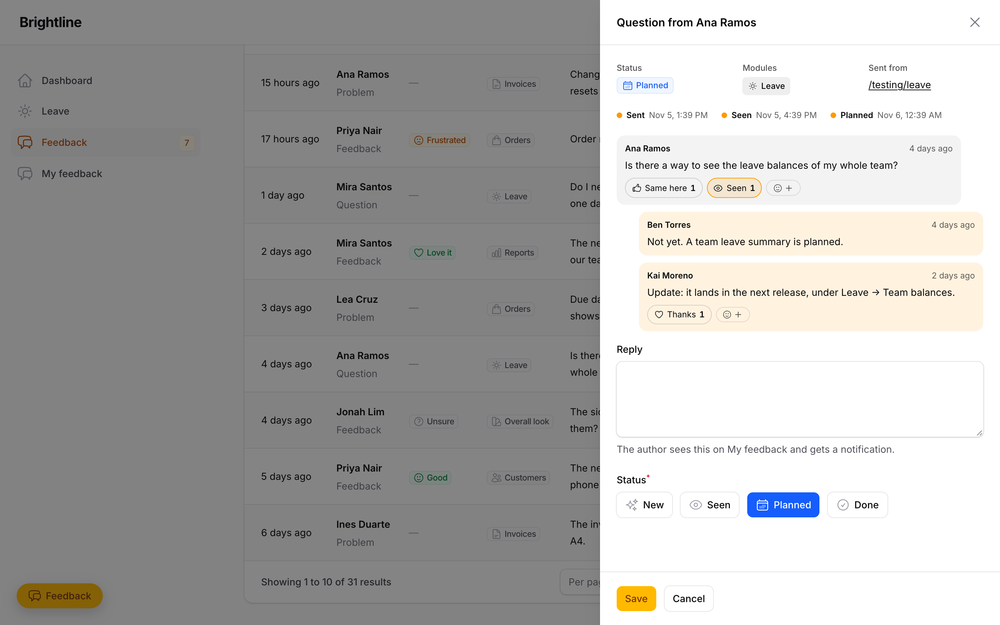

# Filament Feedback

In-app feedback for Filament panels. People press **Feedback** on any page, and a small
sheet opens above the button: pick the parts of the app they mean and how they feel, and
write. Their threads live on a **My feedback** page, with the team's replies, reactions and
a Sent → Seen → Planned → Done timeline. The team reads every post in an inbox, replies and
sets a status. A board shows the mood for each module, so you can see how a release landed.

<div class="filament-hidden">

[](https://packagist.org/packages/carljanzell/filament-feedback)
[](https://packagist.org/packages/carljanzell/filament-feedback)
[](https://github.com/Darkify19/filament-feedback/actions/workflows/ci.yaml)
[](https://github.com/Darkify19/filament-feedback/blob/main/LICENSE)

</div>

<picture>
  <source media="(prefers-color-scheme: dark)" srcset="https://raw.githubusercontent.com/Darkify19/filament-feedback/main/art/inbox-dark.png">
  
</picture>

- Works on **Filament 3.3, 4 and 5** from one codebase.
- Four kinds of post: feedback, a question, a problem, or a note for the developers (which
  can be limited to the dev team and ping its own Chat space).
- Private by default: a post is seen by its author and the people you let triage.
- Modules stay compact: the page's module is pre-picked, the rest sit behind a search, and
  typing `#DTR` (or `#BreakRoom`, `#dtr`, …) in the message tags one with autocomplete.
- Module chips use your app's own navigation icons.
- Reactions (Thanks, Same here, Seen, Fixed) and a "Did this fix it?" check once a post is Done.
- Replies send on Enter (Shift+Enter for a new line), and can be unsent (`allowUnsend()`).
- Stats on the inbox: posts, median first-reply time, what got done, and mood against the
  30 days before.
- Motion by anime.js, loaded only when the viewer allows motion.
- Optional Google Chat ping for every new post.

Full documentation: **https://darkify19.github.io/filament-feedback/**

> Pre-release. See [ROADMAP.md](ROADMAP.md) for what's in, what's next and what 1.0 means.

## Screenshots

<picture>
  <source media="(prefers-color-scheme: dark)" srcset="https://raw.githubusercontent.com/Darkify19/filament-feedback/main/art/sheet-dark.png">
  
</picture>

<picture>
  <source media="(prefers-color-scheme: dark)" srcset="https://raw.githubusercontent.com/Darkify19/filament-feedback/main/art/my-feedback-dark.png">
  
</picture>

<picture>
  <source media="(prefers-color-scheme: dark)" srcset="https://raw.githubusercontent.com/Darkify19/filament-feedback/main/art/inbox-thread-dark.png">
  
</picture>

## Install

```bash
composer require carljanzell/filament-feedback:^0.4
php artisan migrate
php artisan filament:assets
```

## Set up

Register the plugin on each panel that needs it. A typical app has one panel everyone
uses (the button) and an admin panel (the inbox):

```php
use CarlJanzell\FilamentFeedback\FilamentFeedbackPlugin;

$modules = [
    'dtr' => 'DTR',
    'leave' => 'Leave',
    'design' => ['label' => 'Overall look', 'icon' => 'heroicon-o-swatch'],
];

// The panel staff use: the floating Feedback button and My feedback, no inbox.
$panel->plugin(
    FilamentFeedbackPlugin::make()
        ->modules($modules)
        ->moduleFromRoute(fn (?string $route): ?string => str_contains((string) $route, 'leave') ? 'leave' : null)
        ->inbox(false)
        ->chatWebhook(env('FEEDBACK_CHAT_WEBHOOK')),
);

// The admin panel: the inbox, no button.
$panel->plugin(
    FilamentFeedbackPlugin::make()
        ->modules($modules)
        ->button(false)
        ->canTriage(fn (): bool => auth()->user()?->hasRole('admin') ?? false)
        ->navigationGroup('System'),
);
```

A one-panel app keeps both on (the default) and only sets `canTriage()`.

| Method | Default | What it does |
|---|---|---|
| `modules(array\|Closure)` | `[]` | The parts of the app people can tag: `slug => label`, or `slug => ['label' => …, 'icon' => …]`. With none, the field is hidden. |
| `moduleFromRoute(Closure)` | none | Pre-selects a module. Receives `$route` and `$url` and returns a slug or null. |
| `canTriage(bool\|Closure)` | `false` | Who opens the inbox and replies as the team. |
| `button(bool\|Closure)` | `true` | The floating Feedback button on every page, and the My feedback page. A closure is checked on each page and hides only the button. |
| `inbox(bool)` | `true` | The Feedback inbox page. |
| `launcherAttributes(array)` | `[]` | Extra attributes on the button's wrapper, for your own CSS. |
| `impersonateUsing(?Closure $callback, bool\|Closure $can = true)` | off | "View as" on an inbox thread: sign in as the author and open the page they wrote from. The callback does the impersonating with the app's own package (no dependency here), gets `$author`, `$post`, `$url` (on this app and still routed, else null: fall back to their home) and `$guard`, and returns a redirect, or false. `$can` gets `$author`; triagers only. |
| `chatWebhook(?string)` | none | A Google Chat space webhook. Each new post sends it one line. |
| `developerPosts(bool $enabled, bool\|Closure $canRead, ?string $chatWebhook)` | on, every triager reads | The "For the developers" box. `canRead` limits who sees those posts in the inbox; `chatWebhook` pings the dev team's own space. |
| `allowUnsend(team: bool\|Closure, authors: bool\|Closure)` | team `true`, authors `false` | Who may unsend their own replies. An unsent reply stays as "… unsent a message". |
| `navigationGroup(?string)` | none | Where the inbox sits in the navigation. |

Set it on the panel that has the button: posts are created there.

### Module icons

A module without an icon borrows one from your navigation: the plugin runs each page's and
resource's route through `moduleFromRoute()`, and the first page that maps to a module lends
it its navigation icon. So if `moduleFromRoute()` maps your DTR resource to `dtr`, the DTR
chip shows the same icon as the DTR item in the sidebar. An `'icon'` in `modules()` wins.

### Moving the button

It sits bottom-left, and the sheet opens just above it. Shift both with CSS variables on
`:root`:

```css
:root { --ffb-launcher-bottom: 5rem; --ffb-launcher-left: 1rem; }
```

### View as the author

The package doesn't impersonate anyone itself. Wire it to the package your app already
uses; for example [stechstudio/filament-impersonate](https://github.com/stechstudio/filament-impersonate):

```php
use STS\FilamentImpersonate\Tables\Actions\Impersonate; // Actions\Impersonate on v4+

FilamentFeedbackPlugin::make()
    ->impersonateUsing(
        fn (Model $author, ?string $url, string $guard) => Impersonate::make()
            ->guard($guard)
            ->redirectTo($url ?? '/')
            ->impersonate($author),
        can: fn (): bool => auth()->user()?->hasRole(['hr', 'super_admin']) ?? false,
    );
```

The button shows in the thread only for triagers who pass `$can`, never on their own posts.

While you're signed in as someone, the Feedback button would post as them. Hide it on the
author's panel:

```php
FilamentFeedbackPlugin::make()
    ->button(fn (): bool => ! app(\Lab404\Impersonate\Services\ImpersonateManager::class)->isImpersonating())
    // filament-impersonate v4+: ! \STS\FilamentImpersonate\Facades\Impersonation::isImpersonating()
```

### Google Chat ping

In a Chat space: space name → **Apps & integrations** → **Webhooks** → add one, then copy
its URL into `chatWebhook()`. The app only calls out, so this works from a server Google
can't reach, and it needs no Cloud project. If the option is missing, your Workspace admin
has turned off webhooks.

### Stats

The inbox opens with `CarlJanzell\FilamentFeedback\Widgets\FeedbackStats`: posts in the last
30 days (with a 14-day sparkline), the median time to the team's first reply, posts done and
whether authors confirmed the fix, and the average mood against the 30 days before. Only
triagers see it. It is a plain Filament stats widget, so a dashboard can use it too, for
example [filament-insights](https://github.com/Darkify19/filament-insights)'
`->widgets([FeedbackStats::class])`.

## Hooking in

- `CarlJanzell\FilamentFeedback\Events\FeedbackPosted` fires with `$post` on every new post.
  Listen to it to notify your triagers.
- `CarlJanzell\FilamentFeedback\Events\ReplyPosted` fires with `$reply` on both sides of a
  thread. `$reply->is_from_team` tells you which side.
- The author gets a Filament database notification when the team replies. Its link opens
  that thread on My feedback (`/my-feedback?post=…`). Turn on `->databaseNotifications()`
  on that panel. `notifyAuthorUsing()` receives the same `$url`.
- A link to `#feedback` on any page of the button's panel opens the sheet.

## Data

Three tables: `feedback_posts`, `feedback_replies` and `feedback_reactions`. Authors are
polymorphic (`morphs()`), so any authenticatable model works, UUID keys included.

## For AI agents

The package ships an agent guide at
[`resources/boost/guidelines/core.blade.php`](resources/boost/guidelines/core.blade.php): setup,
every plugin method, events, data and common tasks. Apps using
[Laravel Boost](https://github.com/laravel/boost) pick it up automatically on
`php artisan boost:install` (or `boost:update`). Without Boost, point your agent at that file.
Working on the plugin itself: [AGENTS.md](AGENTS.md).

## Testing

```bash
composer test
```

## License

MIT. See [LICENSE](LICENSE).
